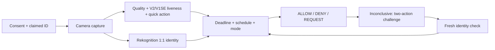

# Secure Entry — liveness and identity verification kiosk

A collaborative HID hackathon prototype combining local face anti-spoofing,
AWS Rekognition 1:1 identity matching, action challenges, access schedules and
offline staff review. One browser interface and one Python service run the flow.

**Research/demo prototype, not production access control.** The first-pass target
is two seconds; human step-up challenges are timed separately. High passive scores
alone never authorize access in the integrated kiosk.

## How it works



Local MiniFASNet V2/V1SE scores are combined with quality and continuity checks.
A randomized quick action accompanies first-pass capture; unresolved cases receive
a longer pose/expression challenge. Identity runs concurrently against the claimed
user's enrolled reference, not a gallery search. A passed fallback challenge still
requires identity, quality and access-policy checks. Offline mode requires staff.

## Run locally — Python 3.11

```powershell
python -m venv .venv
.venv\Scripts\Activate.ps1
python -m pip install -r requirements.txt
python -m pipeline.fetch_third_party
Copy-Item .env.example .env
# Configure credentials and operator key locally.
python run.py
```

Open **http://127.0.0.1:8000** after startup finishes. The service hosts the kiosk,
`/enroll.html`, and `/docs` API reference. On Linux/macOS activate the environment
with `source .venv/bin/activate`. Use a browser with camera permission.

Configure AWS region and credentials with `rekognition:CompareFaces` permission;
temporary credentials also need `AWS_SESSION_TOKEN`. Set a strong `ENROLLMENT_TOKEN`.
Missing or expired AWS credentials cannot produce automatic identity approval.
AWS calls can incur charges. Never commit credentials or enrollment photos.

Enroll a consenting teammate at `/enroll.html`: the operator must check physical
ID and choose an access window and zone. The bundled November 14 schedule is
fictional and expired. Enrollment creates a dated policy for the new user.

## Timing and limitations

The backend bounds inference waiting by the remaining attempt budget (1800ms by
default). The browser watchdog targets 2000ms from initial capture, including slow
start requests and capture. Late results cannot turn timeouts into approvals.
These are software deadlines, not hard real-time guarantees. Browser scheduling,
camera, network and model latency must still be measured end to end. Web timing
starts at initial capture, not confirmed face detection.

The earlier standalone passive demo measured roughly 2.0–2.1 seconds on this PC;
those results are **not** integrated identity-verification benchmarks. No validated
sub-two-second authentication or production spoof-resistance claim is made.
See [evaluation protocol](eval/PROTOCOL.md), [gate findings](eval/WHY_PASSIVE_FAILED.md)
and [validation notes](docs/VALIDATION.md). The passive gate failed and mask testing
is limited; a high score is not a probability of authenticity.

## Tests

```powershell
python -m pip install -r requirements-dev.txt
python -m pytest api/tests -q
```

Tests cover decision combinations, identity isolation, deadlines, late results,
schedules, offline staff review, queue persistence/idempotence, enrollment and
same-origin UI serving. Fake biometric signals test control flow, not accuracy.
GitHub Actions runs these checks on Python 3.11.

## Privacy and project structure

Attempt frames remain in memory, but identity crops are sent to AWS Rekognition.
Enrollment references are intentionally retained locally and excluded from Git.
S3 event synchronization is off by default; configure `S3_SYNC_ENABLED=true` and
`S3_SYNC_BUCKET` to enable it. Offline events remain in the local outbox meanwhile.
Decision logs contain user IDs and metadata, not frames. Bedrock is outside the
decision path. Some calibration tools under `eval/` explicitly retain consented
frames; they are separate from the integrated kiosk.

`web/`: kiosk/enrollment UI · `api/`: identity, orchestration, policy and audit queue
· `pipeline/`: local models and challenges · `eval/`: evaluation and standalone demos.

Preserve teammate authorship. See [portfolio wording](docs/PORTFOLIO.md) and
[model provenance/licenses](pipeline/MODELS.md) before redistributing models.
